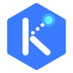

<p align="center">
  
</p>

<h1 align="center">KubeTrek</h1>

<p align="center">
  Learn Kubernetes in your own terminal while the web shows what is happening in your cluster, live.
</p>

> **Status: early development.** Nothing to install yet. Follow the progress below.

## Why learn Kubernetes

Kubernetes is where most companies run their containers, and it shows up in almost every DevOps, SRE and Platform Engineering job posting. It is also hard to learn on your own:

- **You can't see it.** You type `kubectl apply` and get back one line of text. Meanwhile controllers create ReplicaSets, schedule Pods, restart containers and roll out new versions, all out of sight.
- **Tutorials stop at the happy path.** The job is mostly about what breaks: `CrashLoopBackOff`, a Service that routes nowhere, a node that goes `NotReady`.
- **Setting up a practice cluster is a project in itself**, and cloud clusters cost money.

## What KubeTrek does differently

- **A real cluster, not a simulator.** KubeTrek creates a [kind](https://kind.sigs.k8s.io) cluster on your machine. It is free and built with kubeadm, the same way as the clusters in the CKA exam.
- **Plain `kubectl`.** You work in your own terminal with the real tool, so everything you learn carries over to work.
- **You see the cluster react.** A live graph in the browser shows Deployments, ReplicaSets, Pods and Services appearing, changing and dying as you type.
- **Every step checks itself.** Scale to 3 replicas, and the step turns green when 3 Pods are actually ready. No "click here when you're done".
- **You fix broken things.** Each module ends with a challenge: something is broken on purpose, there are no instructions, and you get hints only if you ask.
- **You build a portfolio.** Each level ends with a project you keep in your own repo, like moving a Compose app to Kubernetes or writing a Helm chart with TLS.
- **Kubi guides you.** A small animated assistant explains what just happened, celebrates when you get it right and offers a hint when you're stuck.

## How it works

```
 kind cluster  ◄─ watch ─  ktrek  ── WebSocket ──►  KubeTrek  ── WebSocket ──►  your browser
 (your machine)                                     server                      (graph, steps, Kubi)
```

`ktrek` watches the lesson's namespace and streams changes to the web. It only sends object metadata and status, never the contents of Secrets or environment variable values. The connection starts from your machine, so there are no ports to open.

## What a module looks like

**Pods and Deployments**

1. Apply your first Deployment. ✓ 1 replica ready
2. Delete a Pod and watch a new one replace it. ✓ desired state in action
3. Scale to 3. ✓ 3 replicas ready
4. Roll out `nginx:1.27` and watch it in the graph. ✓ every Pod on the new image
5. Roll back with `kubectl rollout undo`. ✓ previous revision

**Challenge:** "A new version was deployed and the app is down. Fix it."

## Learning path

From your first Pod to production topics. The path follows the CKAD, CKA and CKS curricula and what job postings ask for.

| Level | Topics | Project |
|---|---|---|
| 1. Fundamentals | Architecture, Pods, Deployments, Services, ConfigMaps and Secrets | Move a Compose app (frontend, API, Postgres) to Kubernetes |
| 2. Building on Kubernetes (CKAD) | Probes and resources, storage, Jobs, Ingress and Gateway API, Helm, Kustomize | Helm chart with TLS and dev/prod environments |
| 3. Running the cluster (CKA) | Scheduling, RBAC, NetworkPolicies, autoscaling, etcd backups, upgrades | Multi-team cluster with RBAC, quotas, network policies and a runbook |
| 4. Production (SRE) | Prometheus, Grafana, Loki, Argo CD, Pod Security, operators | |

## Roadmap

- [x] Technical experiments (kind as a library, audit log, informers, resource usage)
- [x] `ktrek up` / `ktrek down`, with automatic shutdown when idle
- [x] Agent that turns cluster changes into messages for the web
- [ ] Relay server and `ktrek connect`
- [ ] Live graph in the browser
- [ ] Module engine and the first modules
- [ ] Accounts with GitHub login and saved progress
- [ ] Installers (Homebrew, script)

---

Kubernetes is a registered trademark of The Linux Foundation. CKA, CKAD and CKS are certifications of The Linux Foundation. KubeTrek is an independent project, not affiliated with or endorsed by them.
